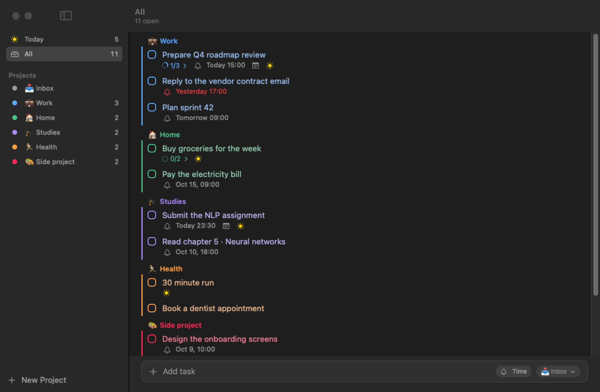
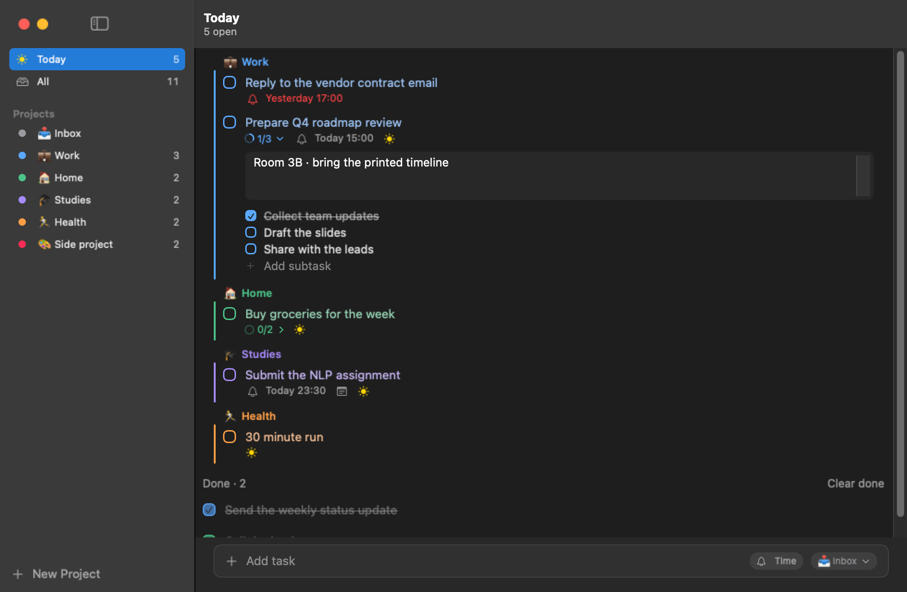
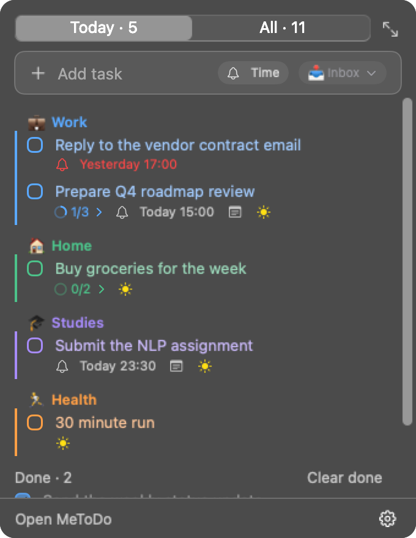
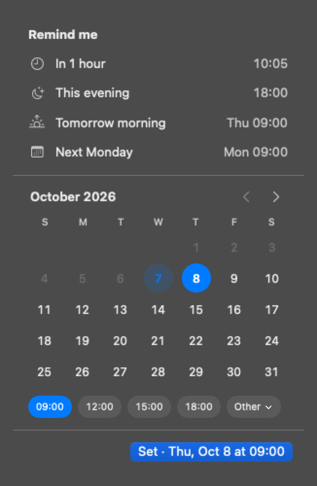
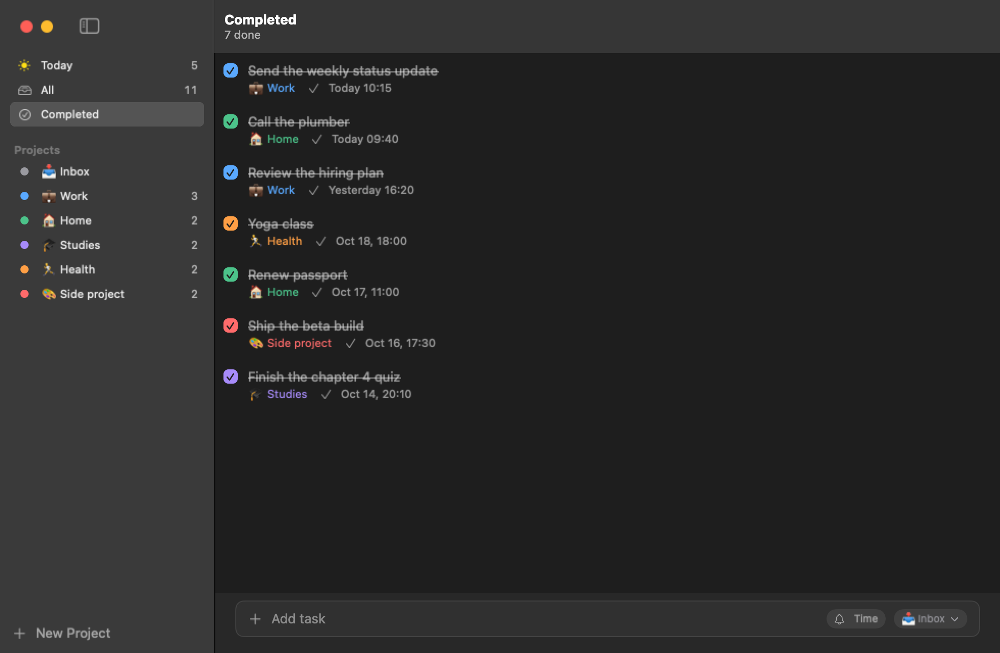
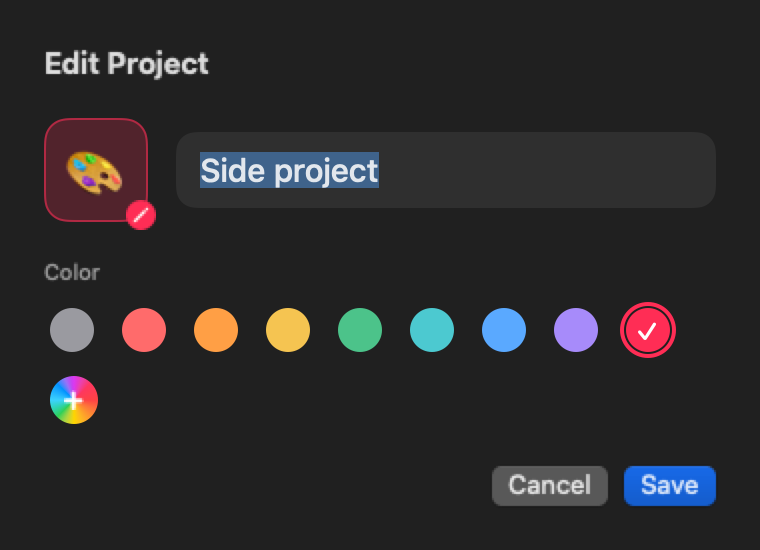
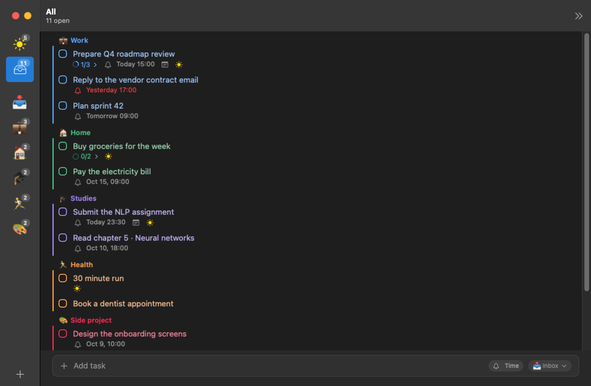

<p align="center">
  
</p>

<h1 align="center">MeToDo</h1>

<p align="center">A minimal to-do app for macOS that lives in your menu bar.</p>

<p align="center">
  
</p>

## Install

Paste this into Terminal:

```bash
curl -fsSL https://raw.githubusercontent.com/josearci/MeToDo/main/install.sh | bash
```

It downloads the latest release, puts **MeToDo.app** in your Applications folder (or `~/Applications` if your account isn't an admin) and starts it. A ✓ appears in your menu bar.

- **Don't see the ✓?** macOS hides menu bar icons that don't fit (e.g. behind the notch) or that are turned off in System Settings › Menu Bar. Opening MeToDo from Applications or Spotlight always shows its window, and ⌃⌥M works either way.
- **Requirements:** macOS 15 or later. Works on Apple Silicon and Intel Macs.
- **Updates:** MeToDo keeps itself up to date. Every change merged into `main` becomes a new release. The app checks for one at launch and every few hours, downloads it in the background, and shows **“Restart to update”** in the menu bar popover.

## What it does

**Projects with colors and emoji.** Group tasks into projects, each with an emoji and one of eight preset colors, or any custom color. Task titles and the color bar beside them take the project's color, so you can tell projects apart at a glance.

**Today, All and Completed.**
- **All** shows everything, grouped by project.
- **Today** shows tasks due today, tasks that are overdue, and anything you pull in with ☀️.
- When Today is empty, you see **Up next**, so there's always something to pick.
- **Completed** lists everything you've finished, newest first, including tasks you've cleared.

**Notes and subtasks.** Click a task to expand it. You'll see its notes and its subtasks, with a progress ring such as ◔ 1/3. Web links in notes (https://…, www.…) are clickable and open in your browser; click anywhere else in the notes to edit them.

<p align="center">
  
</p>

**Reminders that don't get lost.**
- Alerts stay on screen until you act on them: **Complete**, **Snooze 10 min**, **Snooze 1 hr** or **Tomorrow 9 AM**.
- They fire even when MeToDo isn't running.
- The menu bar icon shows a red dot while something is overdue.

**From the menu bar, anywhere.**
- Click the ✓, or press **⌃⌥M** (Control + Option + M) from any app, to open a compact view of your tasks.
- The popover has its own Add field, Today and All tabs, and everything else you need for a quick check.

<p align="center">
  
  &nbsp;&nbsp;
  
</p>

**Quick add.** Type naturally in the Add field:

| You type | You get |
|---|---|
| `Call Ana #work tomorrow 9am` | a task in **Work** with a reminder tomorrow at 9:00 |
| `Pay rent friday` | a reminder on Friday at 9:00 |
| `Stretch in 2 hours` | a reminder two hours from now |

You can also choose the project and time with the chips at the end of the Add field.

**Done stays visible.** Finished tasks stay crossed out at the bottom until you press **Clear done**. Cleared tasks are kept in a history in your data file, ready for stats later: when each was created, completed and due, and how often it was snoozed.

**Reopen anything.** Changed your mind? Open **Completed**, then untick a task or click **Reopen**, and it's back in your lists. Cleared tasks come back with their notes, in their project (or the Inbox if that project was deleted).

<p align="center">
  
</p>

<p align="center">
  
  &nbsp;&nbsp;
  
</p>

**A sidebar that gets out of the way.** Drag the sidebar narrow and it turns into a strip of big project emoji.

## Keyboard

| Keys | Action |
|---|---|
| ⌃⌥M | Show or hide MeToDo from anywhere |
| ⌘N | New task |
| ⌘1 · ⌘2 · ⌘3… | Today · All · projects |
| Space | Complete the selected task |
| Return | Rename the selected task |
| ⌘T | Add to Today or remove from it |
| → / ← | Expand or collapse a task |
| ⌘Z / ⇧⌘Z | Undo / redo |

## Command line and automation

MeToDo comes with a `metodo` command, so you (or an AI assistant in your terminal) can read and change your tasks. The installer links it into `~/.local/bin`. Installed MeToDo before the command existed? Run the installer again, or link it yourself:

```bash
ln -s /Applications/MeToDo.app/Contents/Helpers/metodo ~/.local/bin/metodo
```

```bash
metodo list                       # open tasks; also: list today, list completed, --project work
metodo projects
metodo add "Call Ana" --project work --due "tomorrow 9am" --notes "About the budget"
metodo add --parse "Pay rent #home friday"     # read #project and the date from the title, like the Add field
metodo show 3f2a1b9c              # notes and numbered subtasks
metodo complete 3f2a1b9c          # also: reopen (brings back cleared tasks too), delete
metodo edit 3f2a --title "Call Ana back" --due none --project inbox
metodo subtask add 3f2a "Find the invoice"
metodo subtask complete 3f2a 1    # by number, or by subtask id
metodo list today --json          # full ids and fields, for scripts and assistants
```

- **Ids:** lists show the first 8 characters of each task's id; any unique prefix of 4 or more works.
- **Dates (`--due`):** anything the Add field understands (`tomorrow 9am`, `friday`, `next monday 3pm`, `in 2 hours`), or `2026-10-23`, `2026-10-23 14:30`, ISO 8601. `--due none` removes the reminder.
- **Every option and example:** `metodo --help`.

**Safe while MeToDo is open.** When the app is running, `metodo` hands each command to it: the window updates at once, the change is saved before the command returns, and ⌘Z in the app undoes it. When the app isn't running, `metodo` edits `data.json` itself. A lock file (`data.json.lock`) keeps the two from ever writing at the same time, so nothing gets overwritten. Don't edit `data.json` by hand while MeToDo is open; use `metodo`.

**Links.** Anything that can open a URL (Shortcuts, Raycast, a script, a browser) can use `metodo://` links. They take the same commands, with the options as query parameters:

```
metodo://add?title=Buy%20milk&project=home&due=tomorrow%209am
metodo://add?title=Plan%20trip&today=1&notes=Check%20flights
metodo://complete?id=3f2a1b9c
metodo://reopen?id=3f2a1b9c
metodo://edit?id=3f2a1b9c&due=friday%205pm
metodo://subtask/add?id=3f2a1b9c&title=Book%20hotel
metodo://subtask/complete?id=3f2a1b9c&subtask=1
```

`open "metodo://add?title=Buy%20milk"` works from Terminal. MeToDo opens if it isn't running. Deleting isn't available from a link, since any web page can open one.

## Your data

- **Where it lives:** all your tasks are stored on your Mac, in `~/Library/Application Support/MeToDo/data.json`. A backup copy, `data.json.bak`, is refreshed every time the app starts. To back up, copy that folder.
- **No account, no sync, no tracking.** The only network request MeToDo makes is reading the public release info from GitHub to check for updates.

## Uninstall

Quit MeToDo from the ⚙︎ menu in its popover, then delete **MeToDo.app** from Applications and `~/.local/bin/metodo`. To remove your tasks too, also delete `~/Library/Application Support/MeToDo`.

## Development

```bash
swift test                    # core tests (models, Today logic, quick add, store, CLI, updates)
./scripts/dev-install.sh      # build this checkout, install it into /Applications, link metodo
METODO_DATA=/tmp/test/data.json swift run MeToDoCLI list   # the CLI against throwaway data
```

`METODO_DATA` points both the app and `metodo` at another data file, so you can try changes without touching your real tasks. The CLI's source is `Sources/MeToDoCLI` (the binary is renamed to `metodo` inside the app, in `Contents/Helpers`); the commands themselves live in `Sources/MeToDoCore/CLI.swift` and the app/CLI handoff in `AppLink.swift`.

**How a release happens:** every push to `main` runs `.github/workflows/release.yml`. It runs the tests, builds a universal `MeToDo.app` with `scripts/build-app.sh`, and publishes it as a GitHub Release tagged `v1.0.<commit count>`. Installed copies pick it up on their next update check.

Builds are ad-hoc signed, not notarized. The installer downloads with `curl`, which doesn't trigger Gatekeeper's warning, and the app downloads its own updates the same way.

**To change the app icon:** run `./scripts/make-icns.sh path/to/logo.png`.

The design spec and implementation plan are in [`docs/superpowers`](docs/superpowers).
